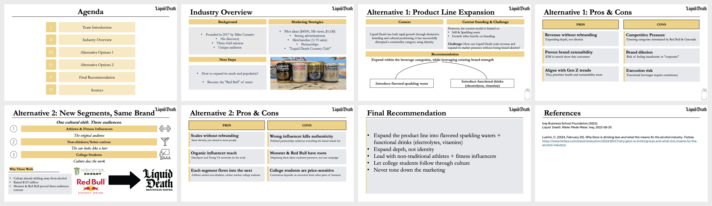
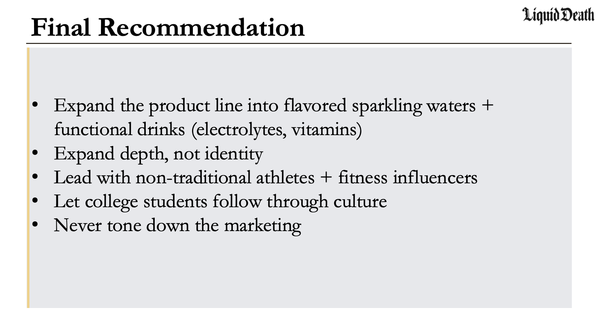

# Liquid Death: Market Expansion Strategy

**1st place, best pitch and solutions.** Cornell Marketing Club MCi Case Program, Spring 2026. Built over 10 weeks with a 3-person team and presented to a 10-member executive board.

**Deck:** [Liquid_Death_Case_Strategy.pdf](Liquid_Death_Case_Strategy.pdf) · individual slides in [`slides/`](slides)

**Team:** Hannah Renner and two Cornell Marketing Club teammates

## The question

Liquid Death grew fast by turning canned water into a brand with an identity. How can it scale revenue and reach more people without losing that identity?

## Options we evaluated

1. **Product line expansion:** flavored sparkling water and functional drinks (electrolytes, vitamins).
2. **New customer segments, same brand:** athletes and fitness influencers, non-drinkers and the sober-curious, and college students.

We weighed each option against competitive pressure from Red Bull, Monster, and Gatorade, the risk of brand dilution, and execution risk.

## Recommendation

Expand the product line into flavored sparkling water and functional drinks, and market it first through non-traditional athletes and fitness influencers. Our reasoning: about $3M in merchandise sales showed customers would follow the brand into new products, so Liquid Death could add revenue without rebranding. We summed it up as "expand depth, not identity."

## Final recommendation

## Sources

- Ivey Business School Foundation (2022). *Liquid Death: Water Made Metal.*
- Ludmir, C. *Why Gen Z is drinking less and what this means for the alcohol industry.* Forbes.

---

*Student case competition project. Liquid Death, Red Bull, Monster, and Gatorade names and logos belong to their owners.*
